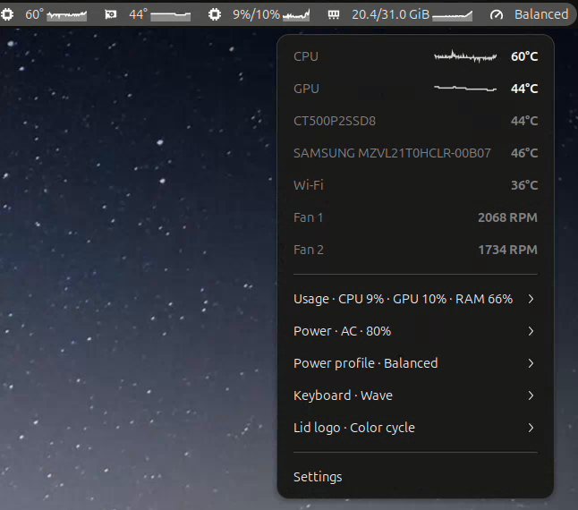
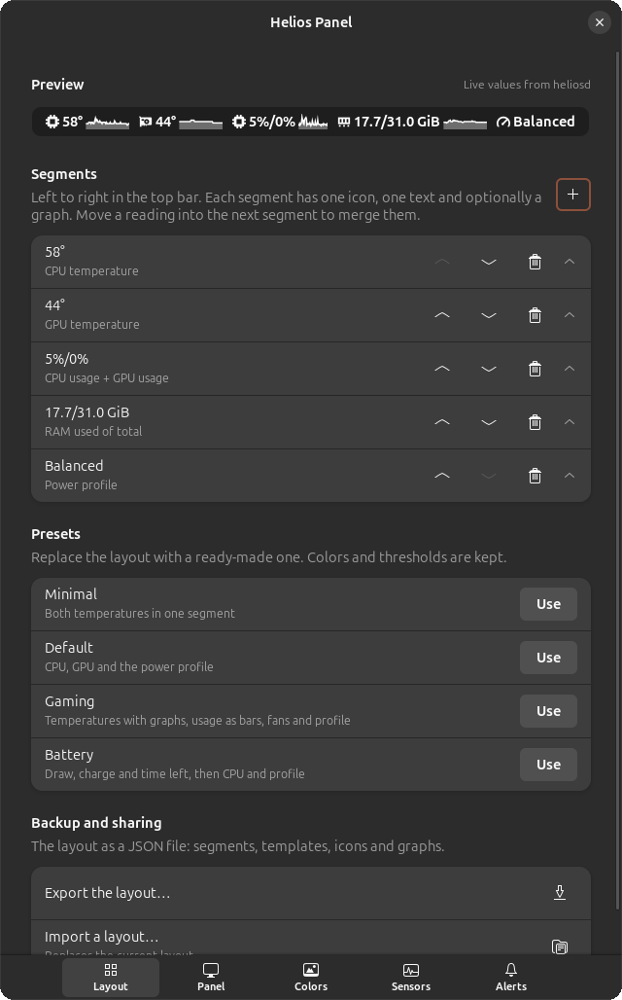
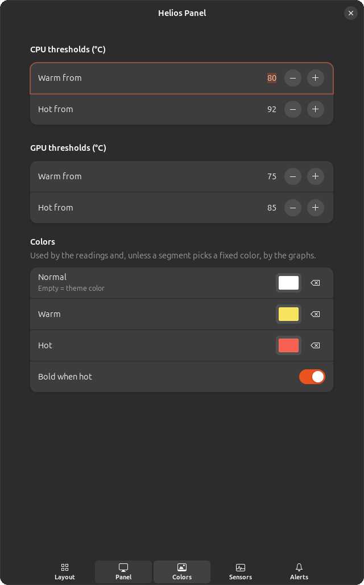
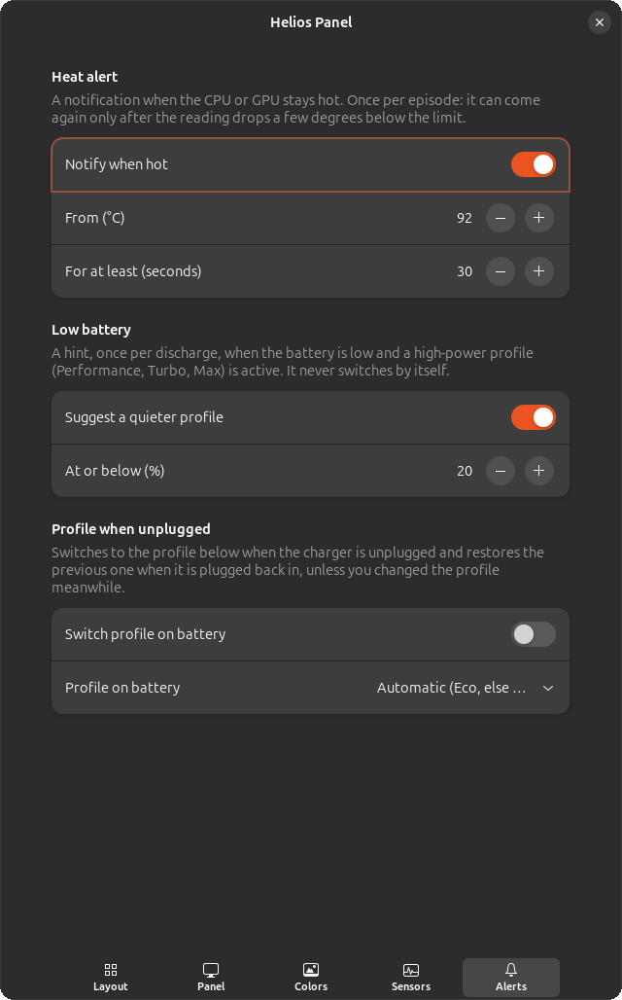

# Helios Panel

<p align="center">
  
</p>

Laptop sensors and the platform profile for Linux, with a GNOME Shell top-bar extension. It shows, next to Wi-Fi and the keyboard layout:

- the **CPU** and **GPU** temperature, changing color as they heat up;
- the current **power profile** (Eco, Quiet, Balanced, Performance, Turbo), switchable from the menu;
- optionally, the **fan** speed;
- optionally, the **power draw** while on battery (a dimmed `AC` when plugged in).

The menu also shows each NVMe or SATA drive's temperature by model name, the Wi-Fi card's temperature, CPU and GPU usage, RAM in use (GiB of the total and percent), the CPU clock (average and fastest core), the battery charge and state, the time left, the battery health (full capacity against the design capacity) the CPU package draw and the NVIDIA GPU's power draw.


This is one layout among many: what it shows, in what order and with which graphs is up to you (see Settings → Layout below).

## Does it work on my machine?

It was built on the Acer Predator Helios Neo 16 (PHN16-72), but most of it uses standard kernel interfaces and works elsewhere:

| Feature | Works on |
|---|---|
| CPU temperature, usage and clock; RAM | any Linux PC: Intel or AMD, laptop or desktop |
| GPU temperature and usage | NVIDIA (proprietary driver) and AMD Radeon; not Intel graphics yet |
| Battery, drives, Wi-Fi card | any laptop battery; NVMe and SATA drives; Intel Wi-Fi cards |
| Power profile switching | any laptop whose kernel driver exposes a platform profile: Acer, ThinkPad, Lenovo, ASUS, HP, Dell… |
| Fan speeds | Acer Predator and Nitro (`acer_wmi` with `predator_v4=1`) |
| Keyboard and lid logo lighting | the PHN16-72 only, with an optional kernel module |

Only the PHN16-72 has been tested on real hardware so far. The full list, how to check your machine before installing, and how to report yours are in [docs/HARDWARE.md](docs/HARDWARE.md).

## How it fits together

- **heliosd**: a small system service. It reads the sensors, publishes them on the system D-Bus and is the only part that changes the platform profile, and only after polkit allows it. It runs sandboxed by systemd, with no capabilities.
- **heliosctl**: a command-line client (`heliosctl status`).
- **helios-acer-lighting** (optional): a small kernel module for the PHN16-72's keyboard RGB effects and lid logo, which Linux does not support yet. Helios never installs or loads it; `heliosctl doctor` prints the commands, and [docs/LIGHTING.md](docs/LIGHTING.md) explains them.
- **The GNOME extension**: draws what heliosd publishes. It never runs anything as root, never reads `/sys` and never spawns processes. Without heliosd it shows `helios off`.

Details are in [docs/ARCHITECTURE.md](docs/ARCHITECTURE.md).

## Requirements

- GNOME Shell 46 to 50, on X11 or Wayland. Developed on Ubuntu 24.04; other distributions with the items below should work.
- systemd, D-Bus and polkit (standard on Ubuntu).
- For the power profile: a kernel driver that exposes `/sys/firmware/acpi/platform_profile`. On Acer Predator and Nitro laptops that is `acer_wmi` loaded with `predator_v4=1`; `heliosctl doctor` shows how to set it.
- For the NVIDIA temperature: the proprietary driver (which ships `nvidia-smi`).
- To build: a Rust toolchain ([rustup](https://rustup.rs)).

## Install

```bash
./install.sh
```

That one command builds heliosd and heliosctl, installs the extension for your user and the system service (it asks for your password once, for `sudo`), and enables the extension. Run it again to upgrade.

GNOME Shell keeps the extension code it loaded at login, so a new version only shows up after the shell reloads. heliosd itself starts on demand.

- **X11:** press **Alt+F2**, type `r` and press Enter. Only gnome-shell restarts; your windows, terminals and running programs stay open. No logout needed.
- **Wayland:** log out and back in (the shell cannot restart in place).

To configure it, open the extension menu → **Settings**, or run `gnome-extensions prefs helios-panel@paulo`. The **Layout** page decides what the top bar shows, with a live preview (heliosd's current values, or sample values when it is not running):

- **Segments**: each one has one icon and one text. Put several readings in one segment to merge them, e.g. `61°/47° · 24.5 W · Turbo`; reorder, add and remove segments.
- **Templates**: a segment's text, e.g. `{cpu}°/{gpu}°` or `{watts} W · {battery}%`. Placeholders give the bare number, so the template adds the unit: `{cpu}` `{gpu}` (°C), `{cpu-usage}` `{gpu-usage}` (%), `{cpu-watts}` `{gpu-watts}` `{watts}` (battery draw, W), `{power}` (draw with its unit, or `AC`), `{battery}` (%), `{time-left}` (h:mm), `{profile}`, `{clock}` `{clock-max}` (GHz), `{ram}` (RAM in use, %), `{ram-used}` `{ram-total}` (GiB, one decimal; e.g. `{ram-used}/{ram-total} GiB`), `{fan}` (all fans) and `{fan1}`, `{fan2}`…; add `:1` for one decimal (`{cpu:1}`). A mistake never breaks the bar: that part shows `--`. A unit glued to a reading (`°`, `%`, ` W`) is left out when the reading shows `--` or `off`. With no template, the readings are joined by ` · ` and the ones the machine lacks (no battery, no GPU…) are left out.
- **Graphs**: any segment can draw the last 1, 2 or 5 minutes of a reading as a **line**, a **filled area** or **bars**, next to its text or alone, following the temperature colors or in one fixed color.
- **Presets**: Minimal, Default, Gaming (CPU and GPU graphs) and Battery, with Undo.
- **Import and export** the layout as a JSON file, to back it up or share it.

The **Colors** page sets the **warm and hot thresholds** and their colors, shared by the top bar, its graphs and the menu. Layouts from before this page existed are converted once, on first run, so nothing you set up is lost.

<table>
  <tr>
    <td></td>
    <td></td>
    <td></td>
  </tr>
  <tr>
    <td align="center">Layout</td>
    <td align="center">Colors</td>
    <td align="center">Alerts</td>
  </tr>
</table>

### Alerts

The **Alerts** page in Settings has three options. They react to heliosd's updates (about every 2 s) and use no timers of their own.

- **Heat alert** (on by default): a notification when the CPU or GPU stays at or above 95 °C for 30 s. It comes once per episode and again only after the reading drops 3 °C below the limit. Both numbers can be changed.
- **Low battery** (on by default): when discharging at 20 % or less on a high-power profile (Performance, Turbo or Max), a notification suggests a quieter one. Once per discharge; it never switches by itself.
- **Profile when unplugged** (off by default): switches to the chosen on-battery profile (Automatic = Eco, else Quiet) when the charger is unplugged, and restores the previous profile when it is plugged back in, unless you changed the profile in the meantime. It uses the same `SetProfile` call as the menu, so polkit decides.

To remove everything:

```bash
./install.sh --uninstall
```

The installer records every file and directory it creates in `/usr/local/share/helios-panel/install-manifest`, and `--uninstall` removes exactly those, nothing else. It never touches kernel modules, modprobe configuration, kernel parameters or the initramfs. If a file it would install already exists and was not put there by it, it stops before changing anything.

What goes where:

| File | Destination |
|---|---|
| extension | `~/.local/share/gnome-shell/extensions/helios-panel@paulo/` |
| heliosd | `/usr/local/libexec/heliosd` |
| heliosctl | `/usr/local/bin/heliosctl` |
| systemd unit | `/etc/systemd/system/heliosd.service` |
| D-Bus policy | `/usr/share/dbus-1/system.d/io.github.pauloeduardods.Helios1.conf` |
| D-Bus activation | `/usr/share/dbus-1/system-services/io.github.pauloeduardods.Helios1.service` |
| polkit action | `/usr/share/polkit-1/actions/io.github.pauloeduardods.helios.policy` |

## Where each reading comes from

| Item | Source |
|---|---|
| CPU | `coretemp` "Package id 0" (Intel) or `k10temp` "Tctl" (AMD) |
| NVIDIA GPU | `nvidia-smi`, **only while the card is awake** |
| AMD GPU | `amdgpu` hwmon (prefers the discrete one) |
| Fans | `acer` hwmon (from `acer_wmi`) |
| Power source, battery, draw | `/sys/class/power_supply` (the laptop's own `Mains` and `Battery`; peripherals such as a wireless mouse are skipped) |
| NVIDIA GPU draw | `nvidia-smi`, in the same query as the temperature |
| Drives, Wi-Fi | `nvme`, `drivetemp` and `iwlwifi*` hwmon chips; the drive's model from `device/model` |
| CPU usage | `/proc/stat`, between two reads |
| RAM | `/proc/meminfo`: in use is `MemTotal` minus `MemAvailable`, as `free` counts it |
| CPU clock | `/sys/devices/system/cpu/cpufreq/policy*/scaling_cur_freq` |
| GPU usage | `nvidia-smi` (same query as the temperature) or `amdgpu`'s `gpu_busy_percent` |
| CPU package draw | RAPL energy counter, `/sys/class/powercap/intel-rapl:N` (Intel and AMD) |
| Profile | `/sys/firmware/acpi/platform_profile` |

Reading never needs root, with one exception: the RAPL counter behind the CPU draw is root-only. heliosd already runs as root and owns the file, so it needs no extra privilege, and it publishes that draw only as an average over at least 2 seconds rounded to 0.1 W (see below). `heliosctl status` run as a normal user shows no CPU draw. heliosd reads everything once every 2 seconds for all clients, and clients are told only when something changes.

heliosd also keeps the last 5 minutes of CPU and GPU temperature, CPU, GPU and RAM usage, the CPU draw and the battery draw in memory (150 samples each, never written to disk). The menu draws them as small graphs under each value, and the top bar can too (see below). The extension asks heliosd for them once when it connects and then adds the values heliosd already sends, so the graphs cost no extra calls.

### Why the CPU draw is coarse

The kernel made RAPL root-only after the [PLATYPUS](https://platypusattack.com/) attack (CVE-2020-8694), which recovers secrets from fast, fine-grained energy samples. heliosd shares the reading with every user, so it never publishes anything finer than one 2-second average, rounded to 0.1 W: enough to see what the CPU draws, far too coarse for that attack.

### Why the draw is only shown on battery

On AC, Linux has no reading for what the whole laptop draws. On battery it does: what flows out of the battery. So the panel shows watts on battery and `AC` when plugged in. The time left uses the draw averaged over about a minute, so a short spike does not make it jump.

### The NVIDIA GPU shows "off"

That means it is powered off to save battery (on-demand mode). Reading the temperature with `nvidia-smi` would wake the card, so heliosd never queries a card that is asleep, and spaces out its queries so it does not keep the card from going back to sleep.

## Switching profiles

The menu lists every profile the firmware offers (`platform_profile_choices`). Switching goes through heliosd, which accepts only those values and asks polkit first. By default, any user in the active local session may switch without a password, like the keyboard mode key, which keeps working too.

From a terminal:

```bash
busctl --system call io.github.pauloeduardods.Helios1 /io/github/pauloeduardods/Helios1 \
    io.github.pauloeduardods.Helios1.Profile SetProfile s quiet
```

## Command line

```bash
heliosctl status          # human-readable
heliosctl status --json   # machine-readable
heliosctl status --watch  # refreshed every 2 s, with the last 2 minutes as small graphs
heliosctl doctor          # check the setup and suggest fixes
```

`heliosctl` reads the sensors directly and works without heliosd or root. An NVIDIA GPU that is asleep is reported as `off` and never woken.

`heliosctl doctor` checks that the laptop is an Acer Predator or Nitro, that `acer_wmi` is loaded with `predator_v4=1` (and where that is set), that no modprobe.d file or kernel parameter blocks it, that the platform profile exists, and that heliosd is installed and running. It only reads: when something is wrong it **prints** the commands to fix it, for you to run. It exits with 1 when something needs attention.

```
[ ok ] machine          Acer Predator PHN16-72 (Predator Helios Neo 16), BIOS V1.20
[ ok ] acer_wmi         acer_wmi is loaded with predator_v4=1
[ ok ] predator_v4      set at boot by /etc/modprobe.d/acer-predator.conf:1
[ ok ] platform_profile balanced (acer-wmi); choices: low-power, quiet, balanced, balanced-performance, performance
[ ok ] lighting         helios-acer-lighting is loaded and bound to the gaming WMI device
[ ok ] heliosd          installed and running (pid 1911038)

Nothing to fix.
```

## Development

```bash
cargo test --workspace                                    # Rust tests (fake sysfs, private D-Bus, never the real ones)
cargo clippy --workspace --all-targets -- -D warnings
cargo fmt --all --check
npm test          # extension tests (node, fake D-Bus, no GNOME needed) and the
                  # kernel module's protocol tests (needs gcc and make)
npm run check     # syntax check of every module

tools/footprint.sh live 120    # what the installed heliosd and gnome-shell cost (read-only)
tools/footprint.sh bench target/release/heliosd 120   # compare two heliosd builds

# reload the extension after ./install.sh: on X11, Alt+F2, r, Enter (no logout);
# re-enabling alone keeps the old code, because GNOME caches loaded modules.

# test in a nested session, without leaving your own session:
dbus-run-session gnome-shell --devkit            # GNOME 49+
dbus-run-session gnome-shell --nested --wayland  # GNOME 46-48

# logs:
journalctl -f -o cat /usr/bin/gnome-shell | grep -i helios
journalctl -f -u heliosd
```

The heliosd integration tests need `dbus-daemon` (package `dbus-daemon` on Ubuntu); each test starts its own private bus.

Helios Panel is licensed under the [GNU GPL v3.0 or later](LICENSE).

Commits and pull request titles follow [Conventional Commits](https://www.conventionalcommits.org/en/v1.0.0/); see [CONTRIBUTING.md](CONTRIBUTING.md).
